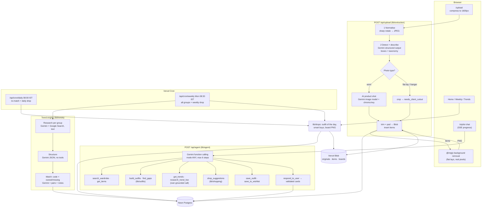

# Closet: AI wardrobe stylist + trend agent

Upload photos of your clothes; Closet finds every item, cuts each one out, and tags it like a Myntra/Ajio listing. Then it builds outfits from what you own, tells you what's trending this week (researched daily with Google Search), and when your wardrobe falls short, tells you exactly what to buy, with Myntra, Ajio, Nykaa Fashion and Amazon search links.

**Live:** https://wardrobe-diaries-1i7u.vercel.app

## What it does

| Area | Pages | Highlights |
|---|---|---|
| Digitise | `/upload` | One photo per request: detect every item, cut it out, extract ~25 attributes; review and edit every attribute; debug box view |
| Browse | `/wardrobe`, `/item/[id]` | Myntra-style filters with counts, search, shareable filter URLs |
| Style | `/style`, `/lookbook` | Anchor mode (one item, 5 ways) and occasion mode; Pinterest-style outfit boards (PNG); save, download, share |
| Stylist agent | `/stylist` + floating button | Gemini function-calling agent: wardrobe first, then gaps, trends and shop links; answers as cards |
| Trends | `/trends` | 7 category groups researched with Google Search grounding, sources on every card, Owned ✓ / Missing |
| Drops | `/` (Home), `/weekly` | Daily outfit of the day + trending item you're missing; weekly headline, top trends, 3 smart buys |
| Shopping | `/wishlist` | "To buy" cards with marketplace search links, trend badges, price bands |

## Look and feel

**Coquette Bow** theme (chosen from 15 directions): ivory, ribbon red and rose, Playfair Display italic with Nunito, soft rounded cards with dashed "lace" edges and a faint dot pattern. Motion uses `framer-motion` and respects reduced-motion settings: Home opens on an **interactive wardrobe** (inspired by a furniture-configurator animation): your tops, dresses and jackets hang and sway on the rail, bottoms and bags sit on shelves, shoes and jewellery live in drawers. On load the lights come on, the door slides open and the drawers slide out; Lights (on/off), Door (open/wood/frosted glass) and Drawers (closed/open) can be toggled, ‹ › browses the rail, and every piece links to its page. Below it, today's outfit pieces glide onto a runway one by one, hold, drift away and the next look comes in; cards ease in on load. The stylist is a hanger-tee button in the corner of every page (not in any menu). Menus and wardrobe filters (groups and options) are alphabetical, and a filter with more than 5 options shows 5 plus "Show more".

## Stack

Next.js 15 (App Router) · TypeScript · Tailwind CSS 4 + shadcn/ui · Google Gemini (`@google/genai`) · Neon Postgres (`@neondatabase/serverless`, no ORM) · Vercel Blob · Vercel Cron · sharp · `@imgly/background-removal` (browser) · zod · react-markdown.

Models: `GEMINI_MODEL` (default `gemini-flash-latest`; the live site pins `gemini-3.8-flash`) and `GEMINI_IMAGE_MODEL` (default `gemini-3.1-flash-image`) for product-shot cutouts.

## Architecture



## Local setup

```bash
npm install
cp .env.example .env.local   # fill in the values below
npm run db:setup             # creates all tables (safe to re-run)
npm run dev                  # http://localhost:3000
```

Optional: `npm run seed` runs every photo in `seed-images/` through the real pipeline (skipping files it has seeded before) and refreshes trends, so a fresh database is never empty. Seeded flat lays keep their crop; open an item and tap **Real cutout**. `npm test` runs the unit tests (shop URL formats, trend matching).

| Variable | Where to get it |
|---|---|
| `GEMINI_API_KEY` | aistudio.google.com → Get API key |
| `GEMINI_MODEL` | Optional. Blank = `gemini-flash-latest`. |
| `GEMINI_IMAGE_MODEL` | Optional. Default `gemini-3.1-flash-image`. |
| `GEMINI_SEGMENTATION` | Optional, default `off` (see limitations). |
| `DATABASE_URL` | Neon pooled connection string (Vercel → Storage → Neon, or neon.tech → Connect) |
| `BLOB_READ_WRITE_TOKEN` | Vercel → Storage → Blob store → `.env.local` tab |
| `CRON_SECRET` | `openssl rand -hex 32`. Vercel sends it to the cron routes as a Bearer token. |
| `SERPAPI_KEY` | Optional, for "Similar online": serpapi.com → sign up (free, 100 searches/month) → Dashboard → API key |
| `REQUIRE_PASSCODE` / `APP_PASSCODE` | Optional lock. The app is open unless `REQUIRE_PASSCODE=true`; then it asks for `APP_PASSCODE`. |

Check the wiring at `/api/health`.

## Deploying

1. Import the GitHub repo in Vercel. `vercel.json` sets the framework (Next.js), the region (`sin1`, next to Neon Singapore) and the two crons.
2. Storage tab: connect Neon and Blob. Add `GEMINI_API_KEY`, `GEMINI_MODEL`, `BLOB_READ_WRITE_TOKEN` (if Vercel didn't add it) and `CRON_SECRET`. Redeploy.
3. Run `npm run db:setup` once against the production `DATABASE_URL`.
4. Trigger the daily job once by hand:

```bash
curl -H "Authorization: Bearer $CRON_SECRET" https://wardrobe-diaries-1i7u.vercel.app/api/cron/daily
```

Hobby crons run once a day, accurate to within the hour. Functions use Fluid compute (up to 300 s); the trend page still refreshes one group per request so it can show progress. If a drop is missing (e.g. the very first visit), Home builds it on demand.

## Upload review

The AI fills in every attribute. Each card shows **"Here's what I see"** (one sentence plus the details it worked out, e.g. long sleeves, mandarin neck, cotton) and asks only 4 pre-filled questions: type, colour, size (optional) and when you wear it. Everything else is behind **Edit all details**.

## How the extraction pipeline cuts items out

| Photo | Cutout | Badge |
|---|---|---|
| Single item / flat lay / hanger | Background removed **in the browser** from your real photo (`@imgly/background-removal`) | Real cutout |
| Worn (mirror selfie) | Gemini's image model re-draws each item as a product shot on a key colour, which sharp removes | AI product shot |
| Tiny worn items (e.g. a necklace in a full-body shot) | Rectangle crop | Crop |

Every card has **Real cutout** and **Use crop** buttons, so an AI product shot can always be swapped for your real photo. Cutout failures never block saving an item.

**Matching photos (Google Lens).** With `SERPAPI_KEY` set, each worn item's crop is sent to Google Lens (via SerpApi) after upload, and the card shows up to 4 near-identical photos from anywhere on the web (Lens's similarity order, video sites skipped). Tapping one copies that photo into Blob, isolates the item from it, and badges the item **Matched photo** with a "View image source" link. Store names and prices are never shown on your own clothes, only in recommendations and shopping. Results are cached on the item, so each item uses at most one search (the free plan has 100/month); any other item has a **Find online match** button. Big Indian stores block scraping, so this uses Lens's own image results rather than fetching store pages.

## Fitting room (virtual try-on)

`/try-on` is laid out like a shopping-app "fitting room": your closet on the left, you on a podium in the middle (category icons on one side, the look's thumbnails on the other), and **Your look · Style & fit · Shop the look · Recommended for you** on the right. Tap pieces to mix and match (a dress replaces top + bottom, up to 2 accessories), or tap **Try it on me** on any outfit board.

- **Your photo, once:** one full-length photo in everyday clothes. Before it's saved, Gemini checks it: one person, appears adult, full length, regular clothes, nothing revealing or suggestive. Otherwise it's rejected with a reason.
- **Tap to wear:** tapping a piece re-dresses you automatically (several quick taps become one render); the current look stays on screen with a small progress chip while the next one is made (about 10–20 s, mostly image generation).
- **Try it on:** Gemini's image model (`GEMINI_IMAGE_MODEL`) dresses that same person (same face, hair, skin tone and body shape, never reshaped) in exactly the chosen pieces, on a white podium in a grey studio.
- **PG-13 by design:** the prompt requires full, modest coverage (adding a plain layer if a piece would leave skin uncovered), and every generated image is checked again before it's saved; anything that fails is discarded.
- **Cached:** each (photo + set of pieces) is rendered once (about 15–45 s), then instant.
- **Privacy:** the photo and renders live in Vercel Blob at unguessable URLs. Blob URLs are public to anyone who has the link, and the app itself is open unless `REQUIRE_PASSCODE=true`, so turn the passcode on if you share the site address. **Delete** removes the photo and every render.

## Trend engine

Trends refresh **weekly** (Monday cron, or "Refresh" on the page when they're over 6 days old); the daily cron only re-matches them to the wardrobe. Research looks at what celebrities, YouTubers, Instagram creators, Pinterest and street style are wearing, and each trend's one-liner names who's wearing it. Every trend gets a **real photo**: one Google Images search (SerpApi) per trend, copied into Blob, reused when the same trend repeats, with an AI-drawn picture as the fallback (about 35 searches a week). The Trends page is a grid of 5 per category (photo, name, one line); tapping one opens the details.

Each refresh researches 7 category groups (tops, bottoms, dresses & co-ords, ethnic & festive, footwear, jewellery, bags & accessories):

1. **Research:** Gemini with the Google Search tool, plain text, with an explicit instruction to search (and one retry if no sources come back). Grounding redirect links are resolved to the real article URLs, and each trend cites the sources that support its own sentences.
2. **Structure:** a separate Gemini call (no tools) turns the text into JSON using the wardrobe taxonomy. Search grounding and structured output are never combined in one request. Taxonomy words in a trend's title (barrel, halter, lace, velvet…) are added back if the model dropped them.
3. **Match:** code decides *owned*: the item must match every defining attribute, including at least one distinctive one (neckline, fit, fabric, pattern, embellishment, metal tone or colour). Type, length or mood alone never count. One batched Gemini call then picks what each trend pairs with and writes a note.
4. **Save** under one `batch_id`. Pages show the newest batch per group, so the daily cron's 3-group refresh doesn't hide the others.

**Pinterest has no open public trends API**, so the app reads Pinterest, magazine (Vogue India, Elle India, Harper's Bazaar India) and retailer (Myntra/Ajio/Nykaa Fashion) trend coverage through Google Search grounding, and shows the sources on every trend card so you can check them.

## Stylist agent

`/stylist` is a Gemini function-calling agent (`lib/agent/`): the model must call a tool every turn (mode `ANY`), runs at most 6 tool steps, and can only finish through `respond_to_user` (forced on the last step). Tools: `search_wardrobe` (taxonomy filters with neighbour fuzzy matching), `get_items`, `build_outfits`, `find_gaps`, `get_trends` (refreshes the relevant group if trends are over 3 days old), `research_trend_live` (its own Google Search call), `shop_suggestions`, `save_to_wishlist`, `save_outfit`. Outfits, buy cards and sources are referenced by keys the tools returned, and item ids are checked against the wardrobe, so a reply can't contain invented items, links or sources. Progress streams over Server-Sent Events; threads live in `chat_messages`.

## 90-second demo script

1. **Upload (0:00–0:20).** Upload a mirror selfie. Point out the progress copy, then the cards: top, jeans, bag and sneakers, each cut out and tagged. Tap **Debug boxes** to show the detections and stage timings, and the cutout-method badges.
2. **Filters (0:20–0:30).** Wardrobe → filters → **Bottomwear + Black**. Counts update like Myntra.
3. **Trends (0:30–0:45).** Open **Trends**: 35 trends, each with sources. Filter **Missing**, open "Barrel-leg jeans": *you don't own one yet; it would go with your white crop top and blazer*, plus Myntra/Ajio/Nykaa/Amazon buttons.
4. **Stylist (0:45–1:10).** Ask: *"What can I wear with my black jeans? I have nothing."* Show the step chips, the outfit boards built only from your wardrobe, then the To buy cards with 🔥 trend badges and shop links.
5. **Lookbook (1:10–1:20).** Tap **Save** on a board and open the Lookbook; download the PNG.
6. **Today's drop (1:20–1:30).** Back to Home: the weekly drop banner, today's outfit of the day and the trending piece you're missing.

## Known limitations (and how I'd fix them)

| Limitation | Fix with more time |
|---|---|
| **Cutouts:** Gemini segmentation masks are slow and come back empty on current Gemini 3 Flash models, so worn items use AI product shots, which re-draw the item (small details can differ). Busy photos can confuse browser removal. | A dedicated segmentation model (SAM 2 / Grounded-SAM on a GPU endpoint) for real-pixel masks on worn items; keep product shots as an opt-in "clean-up". |
| **Fabric is a best guess** from a photo. | Ask for a close-up or label photo; let the user confirm fabric once, then remember brand/fabric pairs. |
| **Sizes aren't read from photos.** | Read size labels from a label photo; store size per brand and use it to filter shop searches. |
| **Trend accuracy depends on search results** and on the model's reading of them; very new or niche trends can be missed. | Add fixed sources (retailer "new in" pages, Pinterest Trends exports), dedupe across days, and track how long each trend has persisted. |
| **Shopping links are searches, not exact products.** | Affiliate/product APIs (Amazon PA-API, Myntra/Ajio partner feeds) for real products, prices and sizes. |
| **Free-tier rate limits** (Gemini requests, Google Search grounding per day). | Enable billing on the key, cache more aggressively, and queue trend research through the day. |
| **Agent replies take 12–80 s** because outfit building is a full Gemini call. | Stream partial results, cache outfits per anchor/occasion, and use a faster model for the planning steps. |
| **Single user,** no accounts. | Auth (e.g. Clerk/Auth.js) and a `user_id` on every table. |

Fonts in `assets/fonts` (Playfair Display, Inter) are from Google Fonts under the SIL Open Font License; they are bundled because Vercel has no system fonts for the board renderer.
